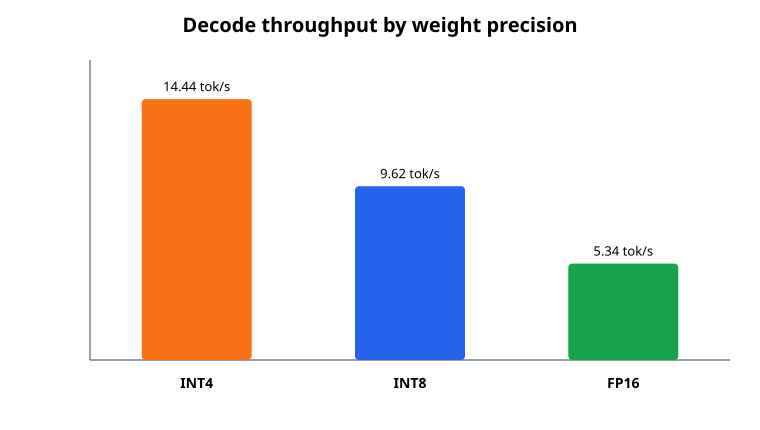
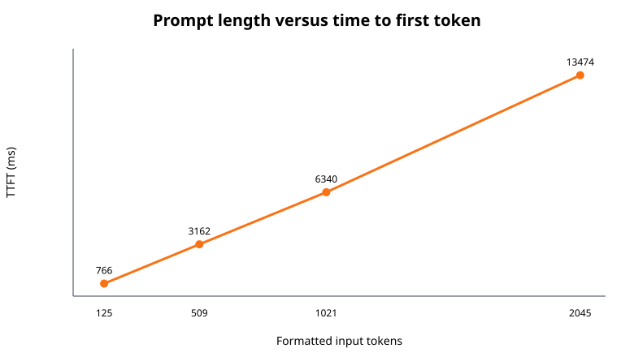

# Benchmark report

The C++ `shikai benchmark` command records raw OpenVINO metrics and responses. The
Python orchestrator adds timestamp, Git revision, model revision, artifact hash,
runtime, precision, thread setting, cache policy, status, and errors. Generated raw
runs remain under ignored `results/run-*` directories.

## Historical precision/context runs — 11 October 2026

The precision study used three prompts, five recorded runs per prompt, one warm-up,
and up to 128 output tokens.

| Precision | Mean TTFT | Mean throughput | Mean peak RSS |
|---|---:|---:|---:|
| INT4 | 342.54 ms | 14.44 tokens/s | 1961.95 MiB |
| INT8 | 303.42 ms | 9.62 tokens/s | 3113.25 MiB |
| FP16 | 923.58 ms | 5.34 tokens/s | 6291.66 MiB |

INT4 had the highest decode throughput and lowest process memory. TTFT does not scale
strictly with weight precision because prefill, compilation, cache state, and system
load also contribute.

The INT4 context study used five repetitions at each actual formatted prompt size.

| Input tokens | Mean TTFT | Mean throughput | Mean RSS |
|---:|---:|---:|---:|
| 125 | 766.39 ms | 15.28 tokens/s | 1969.23 MiB |
| 509 | 3161.84 ms | 14.39 tokens/s | 2025.16 MiB |
| 1021 | 6339.92 ms | 13.87 tokens/s | 2025.33 MiB |
| 2045 | 13474.00 ms | 12.95 tokens/s | 2044.91 MiB |

The final automatic rubric scored INT4 at 1.40/2 and INT8/FP16 at 2.00/2. These are
concept-match scores, not semantic proof; all generated responses are retained.

## Scheduler experiments

| Experiment | Setting | Mean TTFT | Mean throughput |
|---|---|---:|---:|
| CPU threads | 4 | — | 16.48 tokens/s |
| CPU threads | 8 | — | 8.61 tokens/s |
| CPU threads | 12 | — | 8.32 tokens/s |
| Repeated prefix | caching off | 3606.10 ms | 17.23 tokens/s |
| Repeated prefix | caching on | 1754.24 ms | 17.13 tokens/s |
| Long prompt | eviction off | 8080.33 ms | 16.55 tokens/s |
| Long prompt | eviction on | 8299.94 ms | 15.80 tokens/s |

Prefix results are three consecutive requests sharing a 480-word prefix, without a
warm-up. The TTFT reduction is consistent with prefix reuse, while decode speed stays
similar. Eviction uses one recorded long-prompt probe and only establishes that the
configured path runs successfully.

## Charts





Historical keyword quality scores are retained as historical evidence, not accuracy.

## Reproduction

```bash
python scripts/run_benchmarks.py \
  --suite all --repetitions 5 --warmup-runs 1 --max-new-tokens 128
```

## October 20 hardware and cache follow-up

`results/validated-20261020/` includes these original studies plus controlled CPU/KV
and CPU/Intel-GPU comparisons. Runtime-selected CPU threads averaged 17.76 tok/s
versus 17.30 for four threads, with similar sampled RSS. Explicit U8 did not establish
extra RAM savings. Automatic CPU threading and KV precision remain defaults.

The CPU/Intel UHD GPU study used three prompts, three recorded repetitions, one
warmup and 32-token outputs. CPU throughput averaged 17.98 tok/s versus GPU 8.84;
CPU use was 378.53% versus 100.70% (100% is one logical CPU). GPU process RSS was
lower but shared-system GPU buffers occupied about 1254 MiB and can overlap RAM
accounting. No total physical memory reduction is claimed. Six-case rubric means
were CPU 1.17/2 and GPU 0.67/2; long-context recall failed on both. The RTX 3050
is outside the bundled Intel GPU plugin supported targets; the recorded compilation
failure is an unsupported-target attempt, not a supported NVIDIA benchmark. See
[official support references](../guides/hardware-and-benchmarks.md#optional-project-local-intel-gpu-runtime-on-fedora).

## Limitations

- CPU thermals, frequency, power mode, and background load were not externally fixed.
- RSS is whole-process memory and cannot isolate exact KV allocation.
- Automatic matching can miss valid paraphrases; five cases do not establish general accuracy.
- Intel GPU was subsequently benchmarked; NPU was not. RTX 3050 is outside the bundled Intel GPU plugin supported targets.
- Cache-hit counters were not exposed; the prefix finding relies on timing.
- The October namespace-only test skipped; current offline testing falls back to enforced seccomp denial and passed with zero skips.

## November 3 whole-conversation cache result

Three fresh-process, three-turn CPU/INT4 conversations per profile, four threads,
and up to 16 output tokens measured mean follow-up TTFT of **3821.68 ms** for
baseline versus **236.79 ms** for prefix-128 (16.1×), with cold TTFT near **6.1 s**
for both. The separate diagnostic reserved 64.75 MiB for auto/128 versus 1023.86 MiB
for a 1 GB requested pool; U4/128 used **more**, at 73.50 MiB. Eviction showed no clear
benefit. The [KV guide](../guides/kv-cache.md) retains all settings and raw evidence.
The November 7 results below use different prompts/output limits and are not pooled
with these timings.

## November strict quality and cache evidence

The [November 7 snapshot](../results/validated-20261107/README.md) contains 22
objective fixtures and two saved explanations per profile. INT4/auto passed 7/22;
INT8/auto, FP16/auto and FP16/FP16-cache each passed 9/22. These include exact
formatting; they are not general accuracy. All four exact long-context tasks failed
for every profile; explanations await independent review.

The new four-turn conversation workload measured mean follow-up TTFT of 1363.13 ms
for baseline and 104.22 ms for the 64-block automatic prefix profile. Its separate
diagnostic reserved 32.38 MiB versus 64.75 MiB for 128 blocks. U4 used more cache
and passed more declared checks. [Methods](../guides/answer-quality.md) explain
sampling, baseline reuse, fixture failures and uncontrolled laptop conditions.

The [November 9 review](../results/validated-20261109/README.md) passed 28 CTest
cases and 43 Python tests and re-screened retained cache evidence with stricter
provenance/coverage checks. It did not replace historical measurements or invent
new performance observations. The current quality suite uses strict graders;
older keyword plots/scores retain their original meaning.
